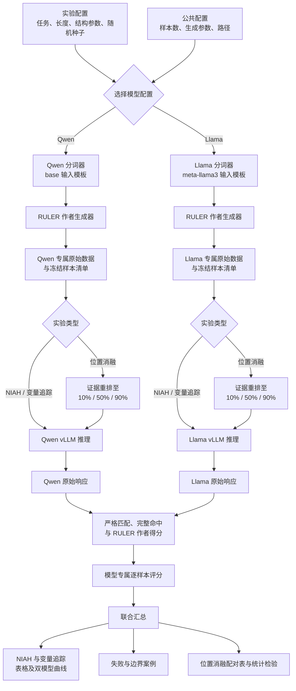

# RULER 课程复现项目实施设计

## 一、设计目标与依据

本工程复现 RULER 的单针检索任务 `niah_single_2` 和多键检索任务 `niah_multikey_1`，增加受控的证据位置消融，并追加变量追踪任务 `vt` 的 $8\mathrm{k}/16\mathrm{k}/32\mathrm{k}$ 双模型实验。主实验使用 Qwen2.5 7B Instruct 与 Llama 3.1 8B Instruct 两个开源模型。

RULER 源码将 Llama 3.1 8B 配置为 `meta-llama3` 模板和 `vLLM` 推理框架，相关设置位于 `../ref/RULER/scripts/config_models.sh`；模板原文位于 `../ref/RULER/scripts/data/template.py`。作者的任务定义、数据生成和长度预算分别来自 `constants.py`、`niah.py`、`variable_tracking.py` 与 `synthetic.yaml`。

两个模型只共享测评过程：任务名称、目标长度、样本数、随机种子、解码参数、评分方法和产出格式相同。每个模型仍使用自己的分词器和输入模板独立运行作者生成器，因此样本正文、实际词元长度和证据位置允许不同。

## 二、项目框架结构

```text
code/
├── configs/
│   ├── base.yaml                    # 公共样本数、随机种子和生成参数
│   ├── models/                      # 两个模型的接口与模板配置
│   ├── experiments/                 # 七个正式主实验条件
│   ├── ablations/                   # 三个证据位置条件
│   ├── variable_tracking/            # 变量追踪的三个长度条件
│   └── pilot/                       # 阶段一小范围闭环
├── data/
│   ├── generated/<model_id>/...     # 作者生成器的原始输出
│   └── manifests/<model_id>/...     # 本工程冻结后的样本清单
├── docs/                            # 设计与运行说明
├── results/
│   ├── raw/<model_id>/...           # 原始模型响应与运行日志
│   ├── scored/<model_id>/...        # 逐样本评分
│   ├── cases/                       # 失败与边界案例
│   ├── summary/                     # 联合汇总和消融统计
│   └── figures/                     # 分任务曲线
├── src/ruler_repro/
│   ├── data/                        # 作者生成器适配、清单和消融构造
│   ├── model/                       # OpenAI 兼容接口客户端
│   ├── pipeline/                    # 生成、推理、评分、汇总和统计
│   ├── reporting/                   # 曲线和案例导出
│   ├── cli.py                       # 统一命令行入口
│   ├── config.py                    # 配置读取与约束校验
│   ├── preflight.py                 # 运行前检查
│   └── schemas.py                   # 统一数据结构
├── tests/                           # 不调用真实模型的自动测试
└── pyproject.toml                   # Python 依赖与命令入口
```

`../ref/RULER` 是只读的上游代码。项目新增逻辑全部位于 `code`，不直接修改作者仓库。

## 三、统一配置接口

### 3.1 模型配置

每个模型配置必须声明以下字段：

- `model_id`：稳定的目录编号，用于隔离数据与结果。
- `model_name`：发送给推理服务的模型名称，必须与 `vLLM --served-model-name` 一致。
- `tokenizer_path`：本地模型与分词器路径，通过环境变量注入。
- `prompt_template_type`：作者生成器使用的输入模板。Qwen 使用 `base`，Llama 使用 `meta-llama3`。
- `context_window`：模型标称上下文上限。
- `base_url`：OpenAI 兼容服务地址。

模型访问令牌和权重路径不写入项目文件。Qwen 使用 `QWEN_MODEL_PATH`，Llama 使用 `LLAMA31_MODEL_PATH`。

### 3.2 实验配置

实验配置描述任务条件，不为每个模型复制一套实验文件。`--model-config` 在运行时选择模型，使同一个 `single_8k.yaml` 能分别生成 Qwen 与 Llama 数据。

主要字段包括实验编号、RULER 任务名称、总序列预算、任务结构参数、样本数和随机种子。NIAH 使用针数并预留 $128$ 个输出词元；变量追踪固定使用一条变量链和四跳传递，每条链形成五个标准变量名，并沿用作者的 $30$ 个预留输出词元。

### 3.3 变量追踪配置

变量追踪配置位于 `configs/variable_tracking/`，三个实验编号为 `vt_8k`、`vt_16k` 和 `vt_32k`。`num_chains=1` 表示生成一条变量赋值链；`num_hops=4` 表示沿链进行四次赋值传递。两个模型分别使用自己的分词器和模板生成样本。

### 3.4 消融配置

证据位置消融增加以下字段：

- `base_experiment_id`：同一模型的基础单针 $8\mathrm{k}$ 实验。
- `ablation_factor`：固定为 `evidence_position`，表示证据位置因素。
- `evidence_position_percent`：目标位置为 $10$、$50$ 或 $90$。

每个模型先独立生成自己的 `single_8k`，再从该模型的基础样本构造三个位置变体。

## 四、统一数据结构

### 4.1 样本记录

`SampleRecord` 保存模型编号、样本编号、实验编号、完整输入、答案前缀、标准答案、目标键、作者长度、复算输入词元数、证据词元位置和随机种子。

消融样本另外保存基础样本编号、消融因素、目标位置和实际位置。实际位置按“证据答案之前的词元数除以完整输入词元数”计算，结果以百分比记录。

### 4.2 模型响应

`ModelResponse` 保存模型编号、原始文本、接口状态、输入与输出词元数、耗时、尝试次数和错误信息。服务失败保留为运行异常，不直接记作模型答错。

### 4.3 评分记录

`ScoreRecord` 同时保存严格答案匹配、RULER 完整命中和 RULER 作者得分。NIAH 的作者得分等于答案是否命中；变量追踪按五个标准变量名的命中比例计分。汇总表为二元正确率计算 Wilson $95\%$ 置信区间，并单独报告变量追踪作者得分的样本均值。

## 五、数据流向



Qwen 与 Llama 的数据流完全分开，目录中的 `<model_id>` 防止同名实验相互覆盖。只有最终汇总阶段同时读取两个模型的结果。

若需要从文件职责和实际命令角度逐步理解上述流程，参见[项目架构与复现流程 Step-by-Step](项目架构与复现流程StepByStep.md)。

## 六、证据位置消融实现

位置消融固定使用单针 $8\mathrm{k}$。程序从同一模型的基础样本中定位唯一证据句，移除后保持背景句子顺序，再把同一句证据插入约 $10\%$、$50\%$、$90\%$ 的句子边界。程序随后用该模型的分词器重新计算长度和实际证据位置。

每个基础样本形成三个配对变体。程序检查证据只出现一次、标准答案仍在输入中、目标位置字段完整、总长度不超过 $8192$。两个模型各生成 $3\times50=150$ 条消融样本。

消融汇总先输出逐样本配对表，再执行 Cochran 的 $Q$ 检验和两两精确 McNemar 检验。前者比较同一批样本在三个位置上的二元正确结果；后者比较两个位置的配对结果；Holm 阈值用于控制三次两两比较造成的误报风险。统计结果属于探索性证据，主要解释仍以正确率和逐例变化为准。

## 七、变量追踪实现

变量追踪由作者的 `variable_tracking.py` 生成。每个样本包含一条初始赋值和四次变量间传递，模型需要找出共享同一数值的五个变量名。严格匹配把作者顺序下以空格连接的五个变量名作为唯一规范答案；RULER 作者得分逐个检查标准变量名是否出现在回答中，并计算命中比例。完整命中率与作者平均得分同时保留，用于区分全部追踪正确和部分链条命中。

跳数消融在 $32\mathrm{k}$ 复用既有四跳结果，并通过 `configs/vt_hops_ablation/vt_32k_hops2.yaml` 独立生成两跳样本。两跳的标准答案包含三个变量名，评分分母随标准答案数量调整。`configs/vt_hops_ablation/vt_32k.yaml` 与主实验的四跳配置完全一致，仅作为联合汇总入口；消融汇总、图与案例使用独立路径，保留原有长度曲线。

## 八、运行接口

统一命令包含：

- `preflight`：检查上游文件、依赖、模型目录和可选的推理服务。
- `prepare`：运行作者生成器，或从基础样本构造消融数据。
- `prepare-ablation`：仅接受消融配置，生成并校验证据位置变体。
- `run`：调用当前本地模型服务，支持跳过已有成功记录和只补跑失败记录。
- `score`：生成逐样本双口径评分。
- `summarize`：生成双模型汇总表和曲线。
- `cases`：导出失败案例；错误不足时补充正确边界案例。
- `analyze-ablation`：生成位置消融配对明细与统计结果。
- `all`：依次完成生成、推理、评分、汇总和案例导出，适合小范围试跑。

每条命令都接受单个 `--config` 或目录 `--config-dir`。`--model-config` 可覆盖实验文件中的默认 Qwen 配置；汇总时可重复传入该参数，同时读取两个模型。

## 九、输出与恢复规则

- 样本清单默认不覆盖；只有明确使用 `prepare --force` 才重新生成。
- 推理按样本编号跳过已有记录；`--retry-failed` 只重试失败记录。
- 每次运行冻结完整配置到 `run_config.yaml`。同一模型与实验目录出现配置冲突时程序停止。
- 评分和汇总可以重复执行，原始响应始终保留。
- 合并组员结果时按模型编号和实验编号复制完整目录，不人工拼接 JSONL 行。

## 十、验证标准

- 七个主实验条件在两个模型下各有 $50$ 条样本和评分，共 $700$ 次正式主实验调用。
- 三个位置条件在两个模型下各有 $50$ 条样本和评分，共 $300$ 次消融调用。
- 联合汇总包含 $14$ 个主实验单元和 $6$ 个消融单元。
- 变量追踪包含 $6$ 个模型—长度单元和 $300$ 次正式调用。
- 全部正式实验合计 $1300$ 次调用和 $26$ 个模型—实验单元。
- 所有汇总数字可以回溯到模型专属样本、原始响应和逐样本评分。
- NIAH 结论只覆盖不超过 $8\mathrm{k}$ 的所测条件；变量追踪结论只覆盖 $8\mathrm{k}$、$16\mathrm{k}$、$32\mathrm{k}$。
