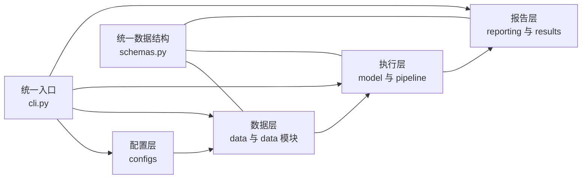
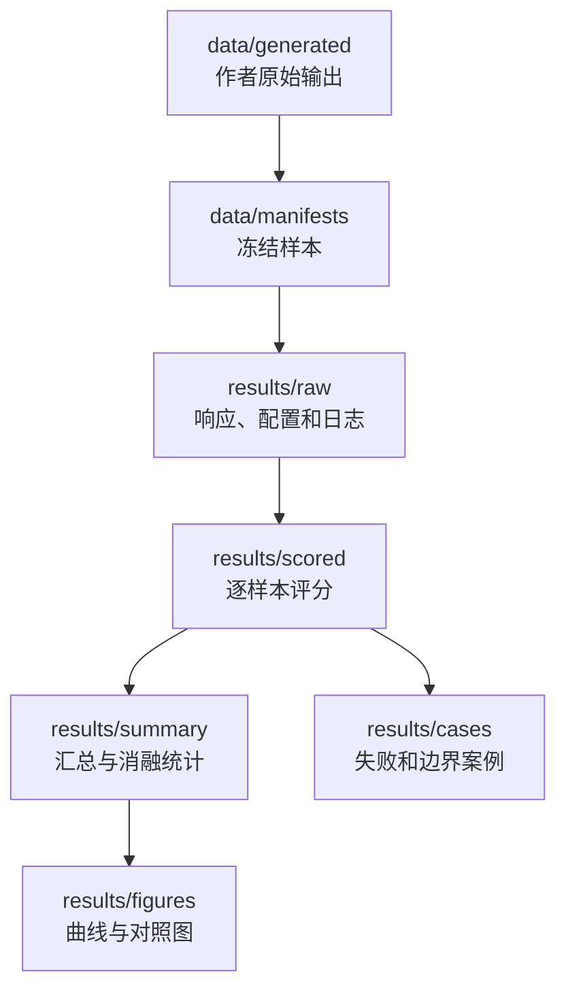
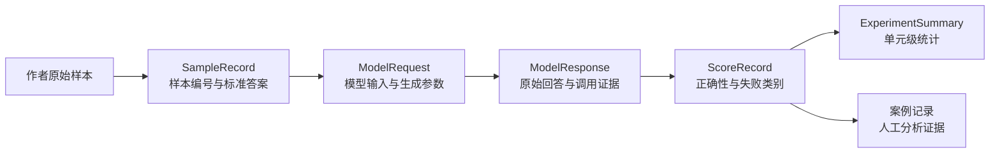

# RULER 项目架构与复现流程 Step-by-Step

## 一、这份导读解决什么问题

本文从两个角度解释项目：第一部分沿着目录逐个说明文件职责，以及文件之间如何调用；第二部分按照实际实验发生的顺序，解释本组从 RULER 配置到最终结果究竟做了什么。

如果需要直接在 AutoDL 执行命令，应阅读[运行与输出说明指南](运行与输出说明指南.md)；如果需要查看接口、数据结构和验收规则，应阅读[项目实施设计](项目实施设计.md)。

## 二、先建立项目的整体认识

项目可以分成四层：配置层规定“测什么”；数据层生成并冻结“拿什么测”；执行层完成模型调用与评分；报告层把逐样本记录整理为表格、曲线和案例。



`cli.py` 是操作入口，`schemas.py` 是各层共同遵守的数据格式。配置和数据始终带有模型编号，使 Qwen 与 Llama 的数据、响应和评分互不覆盖。

## 三、项目根目录中的文件

### 3.1 `README.md`

这是发给组员后最先阅读的入口文件。它概括实验范围，并链接到实施设计、本导读和运行指南。

### 3.2 `pyproject.toml`

这是 Python 项目声明文件，作用包括：

- 声明 Python 运行要求和依赖，例如 `transformers`、`matplotlib` 与 `statsmodels`。
- 告诉安装工具从 `src` 目录查找代码包。
- 注册 `ruler-repro` 命令，使组员不需要直接运行某个 Python 文件。

执行 `python -m pip install -e .` 后，命令行中的 `ruler-repro` 会调用 `ruler_repro.cli:main`。

### 3.3 `data/README.md`

该文件说明数据来源、模型专属目录和旧阶段一文件的处理方式。它同时强调模型权重不放入项目目录。

## 四、`configs`：项目要测什么

### 4.1 `configs/base.yaml`

这里保存所有实验共用的设置：每个正式单元 $50$ 个样本、随机种子 $42$、预留 $128$ 个输出词元、确定性解码参数、失败重试次数，以及数据和结果目录。

### 4.2 `configs/models/qwen2_5_7b_instruct.yaml`

该文件声明 Qwen 的稳定模型编号、服务模型名、服务地址、模型路径环境变量、上下文窗口和 `base` 输入模板。模型路径由 `QWEN_MODEL_PATH` 提供。

### 4.3 `configs/models/llama3_1_8b_instruct.yaml`

该文件声明 Llama 的对应信息。Llama 使用 `LLAMA31_MODEL_PATH` 和 RULER 原项目指定的 `meta-llama3` 输入模板。

### 4.4 `configs/experiments/*.yaml`

七个文件对应七个主实验条件：

- `single_2k.yaml`、`single_4k.yaml`、`single_8k.yaml`：单针的三个长度。
- `multikey4_2k.yaml`、`multikey4_4k.yaml`、`multikey4_8k.yaml`：四针的三个长度。
- `multikey8_8k.yaml`：八针 $8\mathrm{k}$ 对照。

这些文件只描述任务条件。运行时使用 `--model-config` 指定 Qwen 或 Llama，因此不需要复制十四份配置。

### 4.5 `configs/ablations/*.yaml`

三个文件分别声明证据目标位置约 $10\%$、$50\%$ 和 $90\%$。它们都引用同一模型自己的 `single_8k` 基础样本。更换 `--model-config` 后，同一组配置会为另一个模型生成独立消融数据。

### 4.6 `configs/pilot/*.yaml`

这两个配置把样本数缩小为 $2$，分别覆盖单针和四针 $2\mathrm{k}$，用于阶段一验证端到端流程。`formal: false` 表示它们不属于正式结果。

### 4.7 `configs/variable_tracking/*.yaml`

三个配置对应变量追踪的 $8\mathrm{k}$、$16\mathrm{k}$ 和 $32\mathrm{k}$。每个条件使用一条变量链和四次赋值传递，并预留作者规定的 $30$ 个输出词元。A 分别为 Qwen 与 Llama 运行三个配置。

## 五、`src/ruler_repro`：代码怎样协作

### 5.1 `cli.py`：统一命令入口

该文件解析 `preflight`、`prepare`、`prepare-ablation`、`run`、`score`、`summarize`、`cases`、`analyze-ablation` 和 `all` 等命令。它选择实验配置与模型配置，然后把任务交给相应流水线函数。

### 5.2 `config.py`：读取与检查配置

该文件完成四项工作：读取 YAML；合并公共、模型和实验配置；展开模型路径环境变量；检查任务、长度、针数、模板、上下文窗口和消融位置是否合法。配置不完整时，实验会在生成或调用模型前停止。

### 5.3 `schemas.py`：统一数据契约

“数据契约”表示不同模块共同遵守的字段定义。主要结构包括：

- `ModelConfig`：模型身份、服务、分词器和模板。
- `ExperimentConfig`：任务条件、生成参数、路径和消融设置。
- `SampleRecord`：输入、标准答案、实际长度和证据位置。
- `ModelRequest` 与 `ModelResponse`：发给模型的请求和模型返回结果。
- `ScoreRecord`：严格匹配、RULER 完整命中、RULER 作者得分和失败类型。
- `ExperimentSummary`：单个模型—实验单元的汇总指标。

### 5.4 `preflight.py`：正式运行前检查

该文件按任务检查 RULER 上游脚本、模型目录、Python 依赖和 NLTK 句子切分资源；NIAH 另外检查 Paul Graham Essays 背景文件。加入 `--check-server` 后，它还会检查 `vLLM` 服务是否可访问，以及服务暴露的模型名是否正确。

### 5.5 `inference/prompt_renderer.py`：选择模型模板

该文件把 RULER 任务模板包装成模型所需形式。Qwen 的 `base` 模板保留任务文本；Llama 的 `meta-llama3` 模板加入 Llama 3 对话特殊标记。答案前缀随后接在模板末尾，使作者生成器能正确估算完整输入长度。

### 5.6 `data/generator_adapter.py`：调用作者生成器

这是本项目与 RULER 原始数据代码之间的适配层。它读取作者的任务定义和模板，使用当前模型的分词器运行 NIAH 的 `niah.py` 或变量追踪的 `variable_tracking.py`，再把作者输出转换为统一的 `SampleRecord`。

生成结果分别进入：

```text
data/generated/<model_id>/<experiment_id>/
data/manifests/<model_id>/<experiment_id>/
```

前者保留作者生成器原始输出，后者是后续推理读取的冻结清单。

### 5.7 `data/position_ablation.py`：构造位置消融

该文件读取当前模型的 `single_8k` 样本，定位唯一证据句，保留背景句子顺序，再把证据插入目标位置附近的句子边界。程序重新计算输入词元数、证据实际位置，并用 `base_sample_id` 连接同一基础样本的三个变体。

### 5.8 `data/validator.py`：验证样本

该文件检查样本数、编号唯一性、标准答案格式、答案是否出现在输入中、总长度预算和任务专属字段。NIAH 检查七位数字，变量追踪检查五个大写变量名及一条四跳链，消融任务另检查配对字段。验证不通过时不会进入模型推理。

### 5.9 `data/manifest.py`：读写 JSONL

JSONL（每行一个 JSON 对象）是项目的逐样本存储格式。该文件负责安全读取、临时文件写入后替换、追加响应，以及从多次尝试中选择同一样本的最新记录。

### 5.10 `model/base.py` 与 `model/openai_compatible.py`

`base.py` 定义模型客户端应提供的接口；`openai_compatible.py` 实现对本地 `vLLM` 的健康检查和文本补全请求。客户端记录接口词元数、耗时、尝试次数和错误类型，并对临时网络错误执行有上限的重试。

### 5.11 `pipeline/prepare.py`

该文件决定准备数据时走哪条路径：普通主实验调用作者生成器；证据位置消融调用项目自己的位置重排程序。

### 5.12 `pipeline/infer.py`

该文件读取冻结样本，检查运行配置是否与已有目录一致，调用模型客户端，并把每次响应追加到：

```text
results/raw/<model_id>/<experiment_id>/responses.jsonl
```

它同时保存 `run_config.yaml` 和 `run.log`。重新执行命令时会跳过已有成功记录；加入 `--retry-failed` 后只重试失败样本。

### 5.13 `pipeline/evaluate.py`

该文件把样本、最新模型响应和标准答案对应起来，调用两个评分器，并把结果写入 `results/scored/<model_id>/<experiment_id>/scores.jsonl`。它区分格式错误、干扰项混淆、变量追踪部分命中、不完整答案、空回答、无关回答和调用失败。

### 5.14 `scoring/exact_match.py` 与 `scoring/ruler_match.py`

`exact_match.py` 实现课程要求的严格答案匹配，只去除回答首尾空白；多答案任务按作者顺序用空格连接为规范答案。`ruler_match.py` 实现 RULER 的 `string_match_all`：逐个检查标准答案是否出现在回答中，并保存命中比例。完整命中与作者得分分别保存。

### 5.15 `pipeline/summarize.py`

该文件按模型和实验条件统计正确数、正确率、RULER 作者平均得分、Wilson $95\%$ 置信区间、实际词元长度、调用次数和重试次数。正式配置在响应或评分不足 $50$ 条时会停止汇总，防止把不完整结果当作正式表格。变量追踪使用独立文件名，不覆盖 NIAH 汇总。

### 5.16 `reporting/curves.py`

该文件把汇总结果绘制为单针长度曲线、四针长度曲线、四针—八针对照、双模型证据位置曲线和变量追踪作者得分曲线。图像保存在 `results/figures`。

### 5.17 `reporting/cases.py`

该文件导出失败案例。若错误不足要求数量，则补充较长输入或较后证据位置的正确边界案例，并明确标记。项目同时保存联合案例和按模型编号划分的案例。

### 5.18 `pipeline/ablation.py`

该文件把同一模型的三个位置按 `base_sample_id` 对齐，输出逐样本配对表，并计算 Cochran 的 $Q$ 检验、两两精确 McNemar 检验和 Holm 判断阈值。这些统计只作为探索性分析。

## 六、自动测试

### 6.1 `tests/test_config.py`

检查 NIAH、变量追踪和消融配置，以及两个模型的配置覆盖。

### 6.2 `tests/test_prompt_renderer.py`

检查 Qwen 的 `base` 模板直接保留任务文本，并核对 Llama 特殊标记的顺序与 RULER 上游模板一致。

### 6.3 `tests/test_multi_model_layout.py`

检查 $14$ 个主实验单元、$6$ 个消融单元、双模型结果路径隔离和置信区间边界。

### 6.4 其余测试文件

- `test_position_ablation.py`：检查证据重排、答案保留和配对编号。
- `test_model_client.py`：检查临时错误重试次数受到限制并留下记录。
- `test_evaluate.py`：检查主要失败类别和变量追踪部分命中。
- `test_scoring.py`：检查严格匹配、完整命中和变量追踪作者得分。
- `test_manifest.py`：检查 JSONL 往返读写和最新记录选择。

## 七、`data` 与 `results`：运行后会得到什么



所有关键路径都包含 `<model_id>` 或在记录中保留模型编号。最终汇总可以追溯到某个模型、某个实验条件和某条原始响应。

## 八、复现流程 Step-by-Step

### Step 1：确定实验矩阵

七个 NIAH 主实验条件分别用于 Qwen 与 Llama，形成 $14$ 个模型—任务单元；三个位置条件分别用于两个模型，形成 $6$ 个模型—位置单元；三个变量追踪长度分别用于两个模型，形成 $6$ 个模型—长度单元。正式调用总量为 $1300$ 次。

### Step 2：选择模型并启动服务

组员先设置当前模型路径环境变量，再用 `vLLM` 启动一个模型。Qwen 与 Llama 顺序运行，服务暴露的模型名称必须与模型 YAML 中的 `model_name` 一致。

### Step 3：执行预检

`preflight` 检查上游代码、背景数据、依赖、分词器目录和模型服务。该步骤的目的，是在耗费 GPU 时间前发现路径或环境问题。

### Step 4：为当前模型生成主实验数据

`prepare` 合并公共配置、实验配置和当前模型配置。适配器把当前模型的分词器路径与模板交给 RULER 作者生成器。由于两个模型分别执行这一步，它们共享实验条件，但各自得到模型专属样本。

### Step 5：冻结并验证样本

作者输出被转换为 `SampleRecord`，随后检查样本数量、答案、长度和编号。验证后的清单不再自动覆盖，保证推理、评分和案例分析读取同一批数据。

### Step 6：为当前模型构造位置消融

位置消融先要求同一模型已经生成 `single_8k`。`prepare-ablation` 为每条基础样本生成 $10\%$、$50\%$、$90\%$ 三个变体，仅移动证据句，并保存配对编号与实际位置。

### Step 7：调用本地模型

`run` 逐条读取冻结样本，通过 OpenAI 兼容接口向当前 `vLLM` 服务发送补全请求。响应、接口词元数、耗时、重试和错误写入模型专属原始结果目录。

### Step 8：逐样本评分

`score` 同时计算严格答案匹配、RULER 完整命中和 RULER 作者得分。调用失败保持为运行异常；变量追踪回答命中部分标准变量时记录为部分检索。

### Step 9：切换模型并重复

当前模型的负责单元完成后，停止服务并释放显存，再启动另一模型。第二个模型从数据生成开始重复流程，不能直接使用第一个模型的样本清单。

### Step 10：组员回传结果

B 回传双模型单针目录，C 回传双模型四针目录，D 回传双模型八针与位置消融目录。每人同时提供运行环境、失败和重试数量以及候选案例编号。

### Step 11：A 合并并检查完整性

A 按 `<model_id>/<experiment_id>` 合并目录。`summarize` 在正式单元不足 $50$ 条响应或评分时停止，从而暴露漏传或未完成的实验。

### Step 12：生成主实验结果

主实验汇总计算两个模型在单针、四针和八针条件下的正确率、置信区间、实际输入长度和调用量，并生成分任务曲线。

### Step 13：生成消融结果

消融汇总生成六个模型—位置单元的正确率曲线。`analyze-ablation` 再按基础样本配对三个位置，输出逐例变化与探索性统计检验。

### Step 14：导出失败案例

`cases` 从原始响应和评分中导出可回溯案例。案例保留输入、目标键、标准答案、原始回答和判定理由，供报告中的失败分析使用。

### Step 15：完成变量追踪追加实验

A 把两个模型服务的最大长度设置为 $32768$，分别生成并运行 `vt_8k`、`vt_16k` 和 `vt_32k`。汇总同时报告五个变量全部命中的比例与逐变量平均命中比例，并生成长度曲线和独立案例目录。

### Step 16：形成报告结论

报告分别回答三个问题：两个模型在本组所测 NIAH 条件下表现如何；固定某一模型和单针 $8\mathrm{k}$ 后，证据位置变化与正确率有什么关系；变量追踪从 $8\mathrm{k}$ 增长到 $32\mathrm{k}$ 时，完整命中率和逐变量作者得分如何变化。结论只覆盖实际运行的任务、模型和长度。

## 九、一条样本如何贯穿整个项目



这条证据链保证报告中的汇总数字和案例判断都能回到原始输入及模型回答，而不依赖人工抄写的中间结果。
